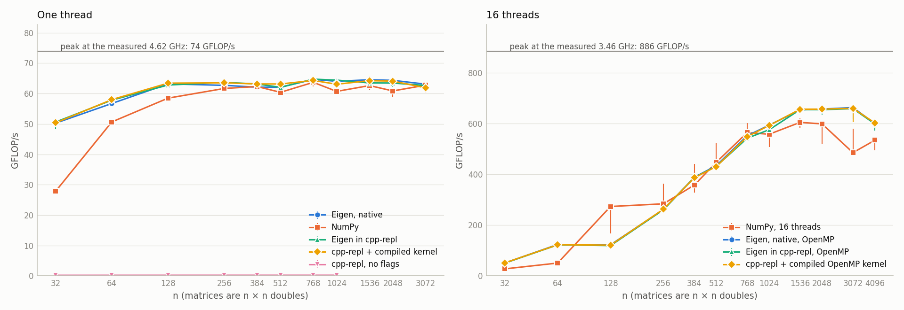

# cpp-repl

A C++ REPL for any library, on top of LLVM's
[clang-repl](https://clang.llvm.org/docs/ClangRepl.html). You type C++ as you
would inside `main()`, and:

- **Blocks finish themselves.** Enter runs an input once its brackets balance
  and its statement is complete, and opens a new line otherwise. A multi-line
  `if` waits for its `else`, a function head such as `int f()` for its body,
  and a `template <...>` line, an attribute or `struct S` for what they head,
  so C++ is typed as it is written.
- **Names can be declared again.** `int x = 1;` then `double x = 2.5;`: the
  session is rebuilt without the old `x` and says so. An input that needs the
  old one keeps it.
- **Values print.** A bare expression prints its value: containers, maps,
  tuples, optionals, variants, smart pointers and wide strings, and your own
  types through their `operator<<`. Profiles add Eigen matrices and OpenUSD
  stages.
- **A crash costs nothing at the prompt.** A segfault, a Ctrl-C or a link
  failure replays the session's journal into a spare clang-repl that is
  already running. Five inputs come back in 0.05 s, every variable with them.
  An exception nothing catches is named and ends the program, not the
  session. (A `--batch` run stops where the program would: at a crash, an
  `exit()` or a `return` from `main()`.)
- **Programs and sessions convert both ways.**
  - `cpp-repl prog.cpp` runs `main()` one statement at a time and leaves you
    at the prompt, its variables in scope.
  - `%save-cpp` writes the session back out as a program that builds.
- **It runs at native speed.** With `-O3 --native`, Eigen typed at the prompt
  multiplies matrices as fast as clang++-compiled Eigen, and as fast as NumPy
  (see [Speed](#speed)). `%timeit` times a statement as IPython does.
- **Errors point at your lines.** An error in a file you run names its line
  and column, `prog.cpp:12:5`, as clang++ would. `--batch` keeps errors brief,
  for a coding agent that fixes the code and runs it again.
- **It points at your project.** It takes `compile_commands.json`, a
  `cpp-repl.toml`, compiler flags and shared libraries.
- **It works with clang-repl 18, 23 and LLVM's development snapshot (24).**
  It works around what each version gets wrong
  ([Why a front end](#why-a-front-end)), and Docker images carry the newest
  ones. The default standard is the newest the clang knows: gnu++26 from
  clang 17.

```
$ cpp-repl --docker
c++> std::vector<int> v{5, 3, 8, 1};
c++> std::sort(v.begin(), v.end(), [](int a, int b) { return a > b; });
c++> v
[8, 5, 3, 1]
c++> std::map<std::string, int> ages{{"ada", 36}, {"alan", 41}};
c++> ages
{"ada": 36, "alan": 41}
c++> for (const auto &[name, age] : ages) {
...>   std::cout << name << " is " << age << '\n';
...> }
ada is 36
alan is 41
c++> int *p = nullptr;
c++> *p = 42;
[clang-repl crashed (SIGSEGV): restored 7 inputs]
c++> v
[8, 5, 3, 1]

$ cpp-repl --docker -p eigen -O3 --native
c++> Eigen::Matrix2d m{{1, 2}, {3, 4}};
c++> m * m.inverse()
Matrix<double> 2×2
    1    0
    0    1
c++> Eigen::MatrixXd A = Eigen::MatrixXd::Random(1024, 1024), B = Eigen::MatrixXd::Random(1024, 1024);
c++> Eigen::MatrixXd C(1024, 1024);
c++> %timeit C.noalias() = A * B;
34.6 ms ± 440 µs per loop (mean ± std. dev. of 7 runs, 10 loops each; JIT at -O3)
```

That product is 62 GFLOP/s on one core of a Ryzen 9 5950X, the same as
clang++ -O3 makes of it.

## Install and run

Linux, Python 3.11 or newer, and either a clang-repl or Docker.

```sh
git clone https://github.com/farhatnadim/cpp_repl.git && cd cpp_repl

bin/cpp-repl                 # uses the newest clang-repl on PATH (Ubuntu: apt install clang-tools-18)
make docker                  # or: an image with clang-repl 23 from apt.llvm.org, about a minute
bin/cpp-repl-docker          # cpp-repl in that image; the same as cpp-repl --docker

pip install -e '.[ui]'       # optional: cpp-repl on PATH, with prompt_toolkit for highlighting as you type
```

Without prompt_toolkit, input goes through readline, a line at a time. With
Pygments, output is coloured. `cpp-repl --docker` mounts the directory it
runs in, the session's working directory, the checkout and whatever your
configuration reads, each at its own path, so paths mean the same inside the
container and out.

### Which clang-repl

| clang-repl | Where it comes from | Notes |
| --- | --- | --- |
| 23 | `make docker` (apt.llvm.org) | Recommended. Runs Eigen's kernels and OpenMP. cpp-repl works around its crash on lambdas at top level. |
| 18 | Ubuntu 24.04, `clang-tools-18` | Most code works. Its JIT cannot assemble inline `asm`, so Eigen's dynamic-size products abort the backend. cpp-repl rebuilds the session, but the product cannot run. |
| main | `make docker-snapshot` | LLVM's development snapshot, for trying fixes that are not released yet. |
| any ref | `make docker-src LLVM_REF=...` | Built from llvm-project in 30 to 60 minutes. |

## Using it

```
c++> std::vector<int> v{5, 3, 8};
c++> std::sort(v.begin(), v.end());
c++> v
[3, 5, 8]
c++> for (int x : v) {
...>   std::cout << x * x << ' ';
...> }
9 25 64
c++> std::map<std::string, int>{{"one", 1}, {"two", 2}}
{"one": 1, "two": 2}
```

- **Enter** runs the input once it is complete. **Esc then Enter** (with
  prompt_toolkit) runs a block as it stands. A pasted block can mix `#include`
  lines and code. If it ends in a bare expression, its value prints, as a
  notebook cell's does.
- **Tab** completes names from every header the preludes include (read
  through the clang++ beside clang-repl), and the session's own names.
  **Ctrl-R** searches the history.
- **Ctrl-C** stops a running input and rebuilds the session without it.
- **A `return N;`** ends the program as `main()`'s return does, and an
  exception nothing catches as `abort()` would; the prompt says so and goes
  on.

| Command | What it does |
| --- | --- |
| `%undo` | drop the last input (the session is replayed without it) |
| `%restart`, `%reset` | rebuild from the journal; start again, empty |
| `%journal` | list the inputs so far |
| `%save FILE`, `%save-cpp FILE` | the journal as a `.repl` file, or as a C++ program |
| `%load FILE` | run a C++ source or a `.repl` file |
| `%lib PATH` | load a shared library |
| `%time INPUT` | run INPUT, then print its wall time and how long the code itself ran, compiling apart (a bare expression's run includes printing it) |
| `%timeit INPUT` | time INPUT in a loop, as IPython does |
| `%flags` | the session's flags, preludes and libraries |
| `%help`, `%quit` | |

### Files

```sh
cpp-repl prog.cpp            # run prog.cpp's main(), then keep the prompt
cpp-repl --batch prog.cpp    # run it and exit
cpp-repl --emit prog.cpp     # print the inputs prog.cpp becomes
cpp-repl a.repl              # a session saved with %save
```

A C++ source becomes inputs like this:
- Each `#include`, `#define` and file-scope declaration or function is one input.
- An `#if ... #endif` region is one input.
- `main()`'s body runs one statement at a time. Its `argc` and `argv` get
  stand-in values.
- A `return` in `main()` runs as it is and ends the program with its value,
  as it does compiled: nothing after it runs, and `--batch` exits with it.
- Quoted includes next to the source are found. A `#pragma` stays with the
  statement after it. `CPP_REPL` is defined, so a source can tell where it
  runs.

Each input reaches clang at its own line and column, so an error names the
place in the file, and so do `__FILE__` and `__LINE__`. An input typed at the
prompt is `<input>`, and input piped in is `<stdin>`.

The code reads cpp-repl's stdin, as the compiled program would:
`cpp-repl --batch prog.cpp < input.txt`. At the prompt it reads the terminal,
and when the inputs themselves come through stdin, it reads end-of-file.

`%save-cpp FILE` writes the session as a program:
- includes and definitions at file scope;
- everything else in `main()`;
- bare expressions as `show(...)` calls.

Build it with the session's own flags:

```sh
clang++ $(cpp-repl -p eigen -O2 --cflags) saved.cpp $(cpp-repl -p eigen -O2 --libs)
```

### In a script or a coding agent's loop

```sh
cpp-repl --batch -q --timeout 30 prog.cpp     # what prog prints, and its errors
cpp-repl --batch --json prog.cpp              # a JSON object per input
```

- **Brief diagnostics.** With `--batch`, or with input piped in, cpp-repl
  shows what fixing the code needs:
  - each input's first error, with its notes;
  - source lines and carets only under a diagnostic in your code;
  - no include chains, and template backtraces of two levels;
  - for a link failure, the first three missing symbols, demangled.

  A wrong `std::sort` comparator costs 23 lines instead of 241.
  `--diagnostics full` shows everything clang prints, as at the prompt.
- **`-q`** leaves out the echo of each input, so that the output is the
  program's own, with the errors where they arise. What cpp-repl says of
  the configuration (a `-std` raised, a profile's note) goes to stderr.
- **`--json`** writes a JSON object per input instead: `input`, `file`,
  `line`, `status` (`ok`, `error`, `link`, `crash`, `exit`, `stuck`,
  `timeout`, `interrupted`, `exception`), `seconds`, `output`, `notes`,
  `run_seconds` for a statement (how long its code ran, compiling it apart;
  a declaration at file scope has none), and `returned` when the input
  returned from `main()`. The last line holds the exit status, the number
  of inputs, the failures, and the inputs skipped once the program ended.
- **The exit status is the program's:** what `main()` returned, the `N` of
  its `exit(N)`, or 128 + the signal that killed it (139 for a segfault, 134
  for `abort()` and for an exception nothing caught, which cpp-repl names:
  `[uncaught exception: std::invalid_argument: stoi]`). It is 1 if an input
  failed to compile or link.
- **`--stop-on-error`** stops at the first input that fails, as the rest
  usually depends on it.
- **`--timeout SECONDS`** stops an input that takes longer, compiling
  included, and rebuilds the session without it. The run goes on, and exits
  with 124 at the end, as `timeout` does.
- **A session that stays.** `cpp-repl --serve SOCKET` keeps a session
  running, its profiles loaded. `cpp-repl --connect SOCKET [FILE...]` runs
  files, or stdin, in it, and exits with the run's status. A run there takes
  0.06 s, against about 2 s for a new cpp-repl, or 4 s with `-p usd`. The
  session's names carry over from run to run. `--fresh` starts a run from an
  empty session instead, for a program run again after an edit, in the spare
  clang-repl the server keeps warm: 0.1 s when the spare is ready, and the
  next spare takes a start-up to warm, so a `--fresh` run sooner than that
  after the last waits for it. `--timeout`, `--stop-on-error`,
  `--diagnostics`, `-q` and `--json` apply to the run; the flags, profiles
  and libraries are the server's. `%quit` stops the server. Whoever connects
  runs code as the server's user, so the socket is created readable and
  writable by that user alone.

  ```sh
  cpp-repl --serve repl.sock -p eigen &
  cpp-repl --connect repl.sock -q --fresh prog.cpp
  echo 'm.rows()' | cpp-repl --connect repl.sock
  ```

### Speed: -O and --native

The JIT compiles at **-O0** unless asked otherwise, which is quick to compile
and slow to run: Eigen's matrix product runs about 300 times slower than
compiled. `-O2` or `-O3` turns the optimiser on, and `--native`
(`-march=native`) lets it use AVX and FMA. With both, code typed at the prompt
runs as fast as clang++'s ([Speed](#speed)). `%timeit` says which level is in
use.

```sh
cpp-repl -p eigen -O3 --native
```

## Your project, your libraries

Compiler flags go to clang as they are: `-I DIR`, `-isystem DIR`,
`-D NAME=VALUE`, `-U NAME`, `-O3`, `-std=c++23`, `-stdlib=libc++`,
`-include FILE` (a prelude of your own, parsed before the first input),
`-march=...`, `-f...`, `-W...`, `-pthread`, `-isysroot`, `--sysroot`,
`--gcc-toolchain=`, `-nostdinc++`. Shared libraries load with `--lib PATH`,
or with `-l NAME` and `-L DIR`, found as the linker finds them: in the `-L`
directories, `$LIBRARY_PATH`, the usual places, then the loader's cache. A
linker script, such as glibc's `libm.so`, is followed to the library it
names. With `-stdlib=libc++`, cpp-repl loads libc++'s runtime first, since
clang-repl itself is linked with libstdc++; the Docker images carry it, and
with it the C++23 library (`std::println`, `std::expected`, `std::mdspan`)
that libstdc++ 13 lacks.

```sh
cpp-repl -I include -DFAST=1 -L build -l mylib -O2
cpp-repl --compile-commands build      # flags as your build compiles: -I, -D, -std, -m, -include
```

From `compile_commands.json`, cpp-repl takes the flags of the entry for the
file you load (or the first entry): its include directories, definitions,
standard, `-m` flags, a forced `-include` as a prelude, and its `-Wno-`
flags. The optimisation level stays the REPL's own.

A `cpp-repl.toml` in the working directory, or any directory above it, says
the same once for a project. `-c FILE` reads another; paths in it are relative
to the file:

```toml
std = "c++23"
include = ["include", "third_party/fmt/include"]
defines = ["FAST=1"]
flags = ["-O2", "-march=native"]
libs = ["build/libmylib.so"]
prelude = ["tools/repl_prelude.h"]   # -include'd into every session
profiles = ["eigen"]
compile_commands = "build"
```

The precedence, from lowest to highest:
1. profiles
2. compile_commands.json
3. cpp-repl.toml
4. `-c` files
5. the command line

For `-I`, the first match wins; for `-D`, the last definition wins. Without
a `-std`, the session compiles as the newest standard its clang knows:
gnu++26 from clang 17, gnu++23 from clang 12. The prelude's templates need
C++20, so a lower `-std` is raised, and the startup line says so. Headers
that use what C++26 removed fail under the default (OpenCV 4.6: arithmetic
between different enumeration types); `std = "gnu++20"` in the profile, or
`-std=gnu++20`, keeps them compiling.

### Profiles

| Profile | What it adds |
| --- | --- |
| `-p eigen` | `<Eigen/Dense>`, found through `EIGEN_ROOT`, pkg-config or the usual places. A matrix prints with its shape; past 10 rows or columns, only the first and last three. A comma initialiser (`m << 1, 2, 3`) prints the matrix it filled; quaternions, angle-axis rotations and transforms print too. |
| `-p glm` | `<glm/glm.hpp>` with the matrix-transform and quaternion extensions, found through `GLM_ROOT`, pkg-config or the usual prefixes. A vector prints as `vec3(1, 2, 3)`, a quaternion as `quat(w, x, y, z)`, a matrix as its rows. |
| `-p usd` | OpenUSD's libraries and `using namespace pxr`. A stage prints its usda; a prim its type, properties and children; an attribute its value and time samples. `tree(stage)` prints the hierarchy. The install is found through the `CMakeCache.txt` next to `compile_commands.json`, then `USD_ROOT`. The session compiles as C++20: OpenUSD's headers do not build as C++23 or later. |

A profile of your own is a `cpp-repl.toml`-style file, loaded with `-c`. To
make your types print, give them a non-member `operator<<` in their own
namespace, where argument-dependent lookup finds it, as it finds it for any
template. cpp-repl finds one defined after the type first printed, in a list
too, and for an enum. A type that merely converts to `bool` or to a number
does not print through the stream's own inserters: it prints as `<Type>`,
with a note that says how to give it a printer. For a display of more than
one line, specialise `repl::Show<T>`; for one line inside a list,
`repl::Put<T>`. See `src/cpp_repl/prelude/cpp_repl.h`, and
`profiles/eigen/cpp_repl_eigen.h` for an example.

### With Claude Code

This repository is also a [Claude Code](https://claude.com/claude-code)
plugin. Its skills add a library to cpp-repl for you:
- they find its headers and shared libraries;
- they write a profile into your project;
- they make the library's types print;
- they check the result with an example session.

```
/plugin install cpp-repl --marketplace farhatnadim/cpp_repl
```

| Skill | What it does |
| --- | --- |
| `/cpp-repl:add-library NAME` | Writes `.cpp-repl/NAME.toml`, a prelude with printers, and an example. Then checks them: the prelude compiles, the session starts, every input runs, the shared libraries are really used, and a `%save-cpp` of the example builds and prints the same. |
| `/cpp-repl:add-printer` | Makes a type print well: a readable display on its own, and one line inside a list. |
| `/cpp-repl:contribute-profile NAME` | In a clone of this repository, turns a working profile into a built-in `-p NAME`, with its tests. The `glm` profile was made this way. |

Asking in words works too, as in "let me try OpenCV in cpp-repl". The skill
hands back one command:

```
$ cpp-repl -c .cpp-repl/opencv.toml
c++> cv::Mat img = cv::Mat::zeros(480, 640, CV_8UC3);
c++> cv::circle(img, {320, 240}, 100, {0, 0, 255}, cv::FILLED);
c++> img
Mat 480×640 8UC3
  (0, 0, 0)  (0, 0, 0)  (0, 0, 0)  ...  (0, 0, 0)  (0, 0, 0)  (0, 0, 0)
  (0, 0, 0)  (0, 0, 0)  (0, 0, 0)  ...  (0, 0, 0)  (0, 0, 0)  (0, 0, 0)
  (0, 0, 0)  (0, 0, 0)  (0, 0, 0)  ...  (0, 0, 0)  (0, 0, 0)  (0, 0, 0)
        ...        ...        ...  ...        ...        ...        ...
  (0, 0, 0)  (0, 0, 0)  (0, 0, 0)  ...  (0, 0, 0)  (0, 0, 0)  (0, 0, 0)
  (0, 0, 0)  (0, 0, 0)  (0, 0, 0)  ...  (0, 0, 0)  (0, 0, 0)  (0, 0, 0)
  (0, 0, 0)  (0, 0, 0)  (0, 0, 0)  ...  (0, 0, 0)  (0, 0, 0)  (0, 0, 0)
c++> img.at<cv::Vec3b>(240, 320)
[0, 0, 255]
c++> cv::Mat gray;
c++> cv::cvtColor(img, gray, cv::COLOR_BGR2GRAY);
c++> cv::countNonZero(gray)
31417
```

- **Nothing else to install.** The plugin puts this checkout's `bin/` on
  Claude Code's PATH, so `cpp-repl` runs as it is.
- **The profile stays in your project,** in `.cpp-repl/`. Nothing is written
  to the plugin.
- **Contributors load their own clone** with `claude --plugin-dir .`, so the
  skills come from the working tree.

## Why a front end

clang-repl is a real C++ JIT, but typed at directly it hangs, crashes or
misprints on everyday input. In what follows:
- *raw* means clang-repl alone, fed over a pipe by
  [`tests/compat/harness.py`](tests/compat/harness.py);
- *cpp-repl* means the same input typed into cpp-repl.

| Raw clang-repl | 18.1.3 | 23.1.4 | 24.0.0 | cpp-repl |
| --- | --- | --- | --- | --- |
| A line ending in an open `{` | hangs (killed after 20 s) | hangs (killed after 20 s) | hangs (killed after 20 s) | waits for the block to close |
| Two top-level range-for loops | prints '1 1 1' and '' | works | works | runs each loop inside a function |
| Nested top-level `for` loops (llvm#89506) | prints '00 01' | works | works | runs the loop inside a function |
| A top-level `try`/`catch` | link error, and later inputs fail | works | works | runs it inside a function |
| A lambda called in a top-level statement | works | crashes (SIGSEGV) | works | runs the statement inside a function |
| A lambda passed to a template in a top-level statement | works | crashes (SIGSEGV) | works | runs the statement inside a function |
| A bare `x + 1`, no semicolon | prints nothing | prints (int) 42 | prints (int) 42 | prints 42 |
| A bare `std::vector<int>{1, 2, 3}` | link error | link error | link error | prints [1, 2, 3] |
| A bare call of a void function | does not run it | does not run it | does not run it | runs it |
| Inline assembly, as in Eigen's matrix product | fatal error: no inline asm in the JIT | works | works | the same (a clang-repl limit) |
| An `#if` region, through an `#include`d file | works | works | works | sends #if regions this way |
| A dynamic initialiser in an `-include`d header | does not run it | runs it | runs it | keeps the prelude free of them |
| A prompt written to a pipe | prints no prompt | prints no prompt | prints no prompt | learns it at startup and strips it |
| The error `%lib` prints for a missing file | error: <path>: cannot open shared object file: No such file or directory | error: <path>: cannot open shared object file: No such file or directory | error: <path>: cannot open shared object file: No such file or directory | uses it as the end-of-output marker |
| How a parse error ends | error: Parsing failed. | error: Parsing failed. | error: Parsing failed. | classifies it as an error |
| `-Xcc -O2` in the JIT | __OPTIMIZE__ = 1 | __OPTIMIZE__ = 1 | __OPTIMIZE__ = 1 | -O2 on its command line |
| The JIT without `-O` | __OPTIMIZE__ undefined | __OPTIMIZE__ undefined | __OPTIMIZE__ undefined | -O0 too; see %timeit's note |
| `-Xcc -march=native` in the JIT | __AVX2__ = 1 | __AVX2__ = 1 | __AVX2__ = 1 | --native |
| `%help` | unknown | known | known | its own %help |
| `%undo` | works | works | works | replays the journal without the last input |

Probed with tests/compat/harness.py: 18.1.3 on 2026-10-14, 23.1.4 on 2026-10-16, 24.0.0 on 2026-10-16.

The way around each problem:
- **The unclosed `{`:** cpp-repl never sends an incomplete input.
- **Loops, `try` and lambdas:** cpp-repl runs these inside a function of their
  own. Lambdas at top level are a new crash in 23.1 and already fixed on
  main.
- **Printing a value:** cpp-repl always calls its own printer. That is how
  class values print in every version.
- **Crash reports:** cpp-repl turns core dumps off before any library loads,
  so a crash leaves no report behind (Ubuntu's apport writes them).

## Speed

The question was how fast C++ typed at the prompt runs, against native
C++ and NumPy. The workload is a dense matrix product of n × n doubles. The
same Eigen source ran compiled by clang++ 23, typed into cpp-repl over
clang-repl 23, and as a kernel compiled ahead of time and called from the
REPL. NumPy ran with OpenBLAS.

The method:
- three rounds;
- pinned cores;
- validity checks on every result;
- hypotheses written down before the first run.

Everything is in [bench/](bench/README.md).



| One thread, n = 1024 | GFLOP/s |
| --- | ---: |
| Eigen, compiled by clang++ -O3 -march=native | 64.0 |
| Eigen typed into cpp-repl -O3 --native | 64.4 |
| cpp-repl calling a kernel compiled ahead of time | 63.1 |
| NumPy (OpenBLAS) | 60.7 |
| cpp-repl with no flags (-O0) | 0.2 |

- **Tuned, the JIT is the compiler.** With `-O3 --native`, Eigen at the
  prompt runs at 0.98–1.02 of native at every size from 32 to 3072. With 16
  threads, OpenMP inside the JIT runs at 0.97–1.00 of native, up to
  660 GFLOP/s.
- **Untuned, it is about 300× slower.** The default is -O0, and leaving out
  `--native` costs almost two thirds of the speed.
- **NumPy was 1.5–6% behind Eigen from n = 512 up,** half as fast at n = 32
  and ahead at n = 384, contrary to the prediction written down before the
  run.
- **What the REPL costs is compile time, not run time.**
  - Cold start to the first product: 3.2 s, against 2.5 s to compile and
    run natively and 0.06 s in NumPy.
  - In a running session, calling the kernel again costs 0.08 s, and a new
    product expression 0.72 s to compile.

## What C++ you can type

Every construct below was typed into cpp-repl on clang-repl 18.1.3, 23.1.4
and the 24 snapshot, with the same result on each (`tests/sessions/` holds
the transcripts):
- the C++20 language: concepts and `requires`, abbreviated templates
  (`auto add(auto a, auto b)`), `consteval`, `constinit`, `if constexpr`,
  structured bindings, designated initialisers, `<=>`, `co_await` in a
  function, `[[nodiscard]]`, user-defined literals, `extern "C"`, static
  locals, `goto`, lambdas anywhere (passed to `std::sort`, immediately
  invoked, in a `std::thread`), class templates with out-of-line members,
  virtual functions, `using namespace std`, multi-line raw strings, digit
  separators;
- the C++23 language where the clang has it (`if consteval`, deducing
  `this`, `auto(x)`), and `std::expected` from clang 19, or with
  `-stdlib=libc++`;
- the standard library of C++20 without an `#include`: containers, ranges and
  views, `std::format`, `std::variant`, `std::optional`, `std::atomic`,
  `std::thread` and `std::jthread`, `std::chrono` literals, `std::numbers`,
  `std::source_location`, `std::span`, `std::bit_cast`;
- an uncaught exception, a `return` from `main()`, `exit()` and a crash,
  each ending the program as it does compiled.

What a version lacks is clang-repl's own: 18's JIT cannot assemble inline
`asm`, so Eigen's dynamic-size products abort there; `<print>`,
`<generator>`, `<mdspan>` and `<flat_map>` need libstdc++ 14 or libc++
(`cpp-repl --docker -stdlib=libc++`), and cpp-repl says so when an
`#include` of them fails. `import std;` has no module file in any of them,
and cpp-repl says so.

## Limits

- **Variables typed at the prompt are globals.** A name can clash with a C
  library function: `int index = 3;` fails.
- **Rebuilding replays the journal,** file writes and other side effects
  included; declaring a name again replays the inputs after its old
  declaration.
- **Code that reads file descriptor 0 itself,** with `read(0, ...)` or
  `/dev/stdin`, reads what cpp-repl sends clang-repl. `stdin` and `std::cin`
  read the program's input.
- **An input with a backslash line splice outside a directive goes as one
  line,** and so does `%timeit`'s, and its errors name `input_line_N`.
- **An exception thrown by a file-scope declaration's initialiser** (`auto
  x = parse("bad");`) still ends the session, which is rebuilt; one thrown
  by a statement is caught and named.
- **Startup takes about 2 s,** or 1.3 s with `--no-std`, which leaves out
  the standard library prelude. A profile adds its headers: Eigen about
  1 s, OpenUSD about 3 s. Docker adds about 0.2 s.
- **Your headers must compile with your clang-repl.**
  - clang 23 rejects TBB 2020's headers, so the `usd` profile needs an
    OpenUSD built against oneTBB there; and OpenUSD's headers do not build
    as C++23 or later, so that profile compiles as C++20.
  - clang-repl 18 can't run Eigen's dynamic-size products, as the table shows.
- **C++20 is the floor.** The default is the newest standard the clang knows.

## How it works

- **[`lexer.py`](src/cpp_repl/lexer.py)** finds where inputs and statements
  end. It decides what clang-repl gets:
  - control flow, lambda statements and expression statements inside a
    function of their own, where a `return` ends the program and an
    exception is caught; declarations and definitions at file scope;
  - each input through a temporary file and an `#include`, after a `#line`
    directive, at its source's lines and columns;
  - a bare expression through `repl::print_expr`.
- **[`diagnostics.py`](src/cpp_repl/diagnostics.py)** filters what clang
  prints: brief or full, and in both without clang-repl's repeated errors.
- **[`backend.py`](src/cpp_repl/backend.py)** runs clang-repl over a pipe.
  - **Marker:** after each input it sends `%lib` of a path that cannot exist.
    The error clang-repl prints marks where the input's output ends, and adds
    nothing to the session.
  - **Calibration:** at startup it learns the marker's text and any prompt.
    It also checks that a parse error is recognised.
- **[`session.py`](src/cpp_repl/session.py)** journals the inputs that
  worked. After a crash, a Ctrl-C, a link failure, `%undo` or a name declared
  again, it replays them into a spare clang-repl started in advance.
- **[`server.py`](src/cpp_repl/server.py)** is `--serve` and `--connect`: one
  session on a Unix socket, for a coding agent's loop.
- **[`prelude/cpp_repl.h`](src/cpp_repl/prelude/cpp_repl.h)** is the C++
  every session starts from: `show`, `Show<T>`/`Put<T>`, `keep` and `timeit`.
  Profiles add their own headers.

cpp-repl began as `repl/usd-repl` in
[openusd-tutorial](https://github.com/farhatnadim/openusd-tutorial), a REPL for learning OpenUSD's C++ API,
and that `repl/usd-repl` now runs cpp-repl's usd profile.
`scripts/parity.py` checks that cpp-repl runs that tutorial's 20 lessons as
their compiled programs do: the same output, the same files written.

## Related work

| Project | What it is | Difference |
| --- | --- | --- |
| [cling](https://github.com/root-project/cling) | CERN's C++ interpreter (ROOT), on its own LLVM fork | Mature and full-featured, but it is LLVM 20 and its own build. cpp-repl uses stock clang-repl, and any of them. |
| [xeus-cpp](https://github.com/compiler-research/xeus-cpp) | A Jupyter kernel over CppInterOp and clang-repl, with a WebAssembly build | Notebooks rather than a terminal. CppInterOp supports up to LLVM 22. |
| [clang-repl-kernel](https://pypi.org/project/clang-repl-kernel/) | A Python Jupyter kernel over clang-repl | Tested with clang 18. |

## Development

```sh
make test          # unit and fake-backend tests: no clang-repl needed
make test-host     # every test against the host's clang-repl
make test-docker   # every test inside cpp-repl:llvm23 (make docker first)
make parity        # openusd-tutorial's lessons through cpp-repl -p usd and compiled, diffed
make compat        # probe the host's clang-repl; make compat-docker for the images
make compat-table  # the "Why a front end" table from the probes
make bench-quick   # a 3-minute benchmark run (make docker-bench first)
claude plugin validate .                                 # the Claude Code plugin and its skills
claude plugin eval . --case yaml-cpp --runs 1 --ablation none   # one skill eval (real model calls)
```

The test suite passes on clang-repl 18.1.3, 23.1.4 and the 24 snapshot
(`make test-snapshot`):
- unit tests;
- a fake clang-repl that prints prompts, splits its output and crashes on cue;
- golden transcripts;
- integration tests for crashes, Ctrl-C, link failures and `%save-cpp` round
  trips.

[AGENTS.md](AGENTS.md) describes the layout and how to probe clang-repl
safely.

## License

MIT. See [LICENSE](LICENSE).
